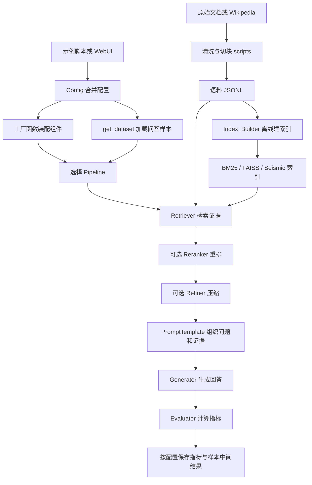
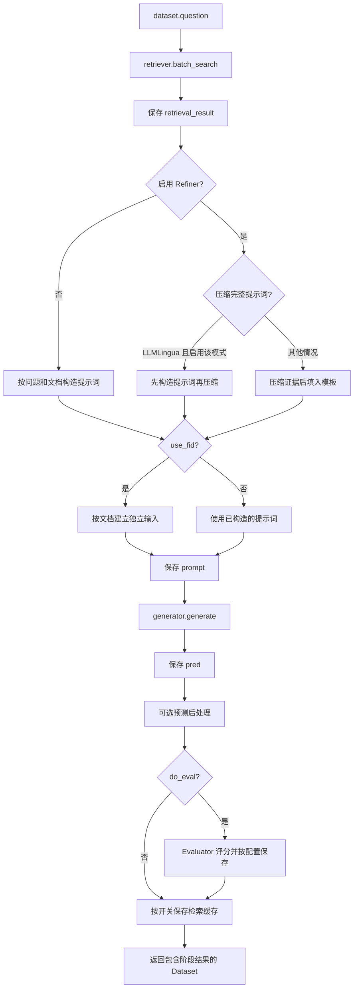
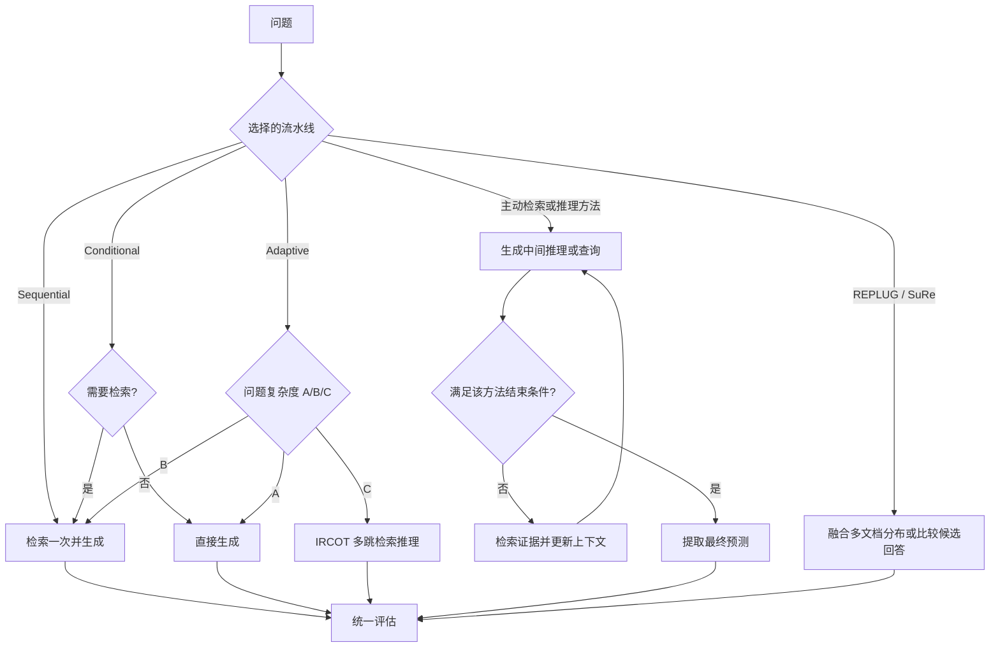
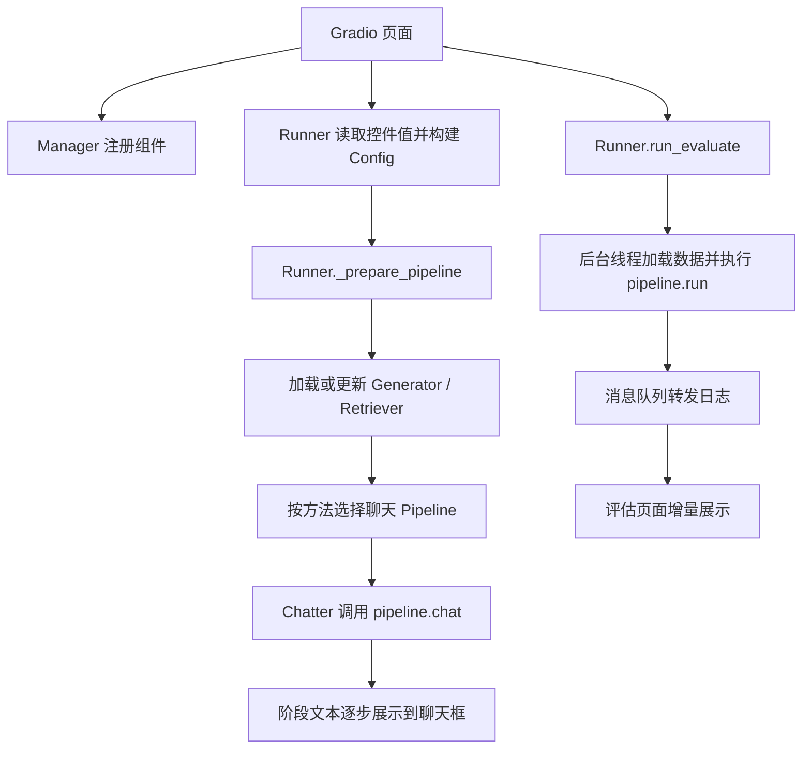

# FlashRAG 项目总体文档

FlashRAG 是一个用来组装、运行和评估不同 RAG 方法的 Python 工具箱。RAG 的核心是：先从外部语料检索证据，再让语言模型结合证据回答问题。本项目的主干是普通 Python 方法调用，不是由某个图执行引擎驱动。

## 项目结构与模块职责

核心实现集中在 `flashrag/`。示例负责启动实验，流水线负责组织算法，各组件分别完成检索、生成和评估。

| 目录 | 职责 | 关键源码 |
| --- | --- | --- |
| `examples/` | 实验和演示入口 | `quick_start/simple_pipeline.py` |
| `flashrag/config/` | 合并配置、初始化路径和运行环境 | `config.py`、`basic_config.yaml` |
| `flashrag/dataset/` | 管理问答样本及阶段输出 | `dataset.py` |
| `flashrag/pipeline/` | 实现不同 RAG 算法的执行流程 | `pipeline.py` 及各扩展流水线 |
| `flashrag/retriever/` | 建索引、编码查询、检索和重排 | `index_builder.py`、`encoder.py`、`retriever.py`、`reranker.py` |
| `flashrag/prompt/` | 将问题与证据组织为模型输入 | `base_prompt.py` |
| `flashrag/generator/` | 对接不同模型推理后端 | `generator.py`、`openai_generator.py` |
| `flashrag/refiner/` | 压缩或精炼检索内容 | `refiner.py` |
| `flashrag/judger/` | 判断是否需要检索或问题复杂度 | `judger.py` |
| `flashrag/evaluator/` | 计算指标并保存结果 | `evaluator.py`、`metrics.py` |
| `flashrag/utils/` | 按配置创建数据集和组件 | `utils.py` |
| `scripts/` | 离线清洗、切块、建索引 | `chunk_doc_corpus.py`、`build_index.sh` |
| `webui/` | 提供配置、聊天和评估界面 | `interface.py`、`engine.py`、`runner.py` |

## 先看整体流程

下图区分一次性的离线准备与每次实验的在线推理；索引文件需要与语料文件配套使用。

不支持 Mermaid 的阅读器可以直接打开 [PNG 图片](./项目总流程图.png) 或 [SVG 矢量图](./项目总流程图.svg)。

重排通常封装在检索器内部，流水线拿到的已经是检索器返回的文档。上图将它展开，是为了说明其作用。条件流水线可能直接跳过检索；多轮方法可能反复执行检索和生成。

## 从最简单的入口追一次调用

建议首先阅读 [simple_pipeline.py](../examples/quick_start/simple_pipeline.py)，而不是直接从复杂算法开始。

1. 解析模型路径，构造 `config_dict`。
2. `Config(config_dict=...)` 合并配置，初始化路径、设备与随机种子。
3. `get_dataset(config)` 加载配置指定的数据划分，示例取 `test`。
4. 创建 `PromptTemplate`，规定问题和证据如何拼接。
5. 创建 `SequentialPipeline`，装配生成器、检索器和可选压缩器。
6. `pipeline.run(test_data)` 执行推理、写回结果，最后调用公共评估流程。

顺序流水线内部的实际分支如下，入口见 [pipeline.py](../flashrag/pipeline/pipeline.py) 中的 `SequentialPipeline.run`。

`use_fid` 分支会重新构造多文档输入。压缩器与 FiD 的组合行为应以这里的源码为准，不能理解为任意压缩器的结果都会被 FiD 使用。

## 数据如何在模块间流动

| 数据或组件 | 作用 | 对应源码 |
| --- | --- | --- |
| 语料文档 | 被检索的知识来源，常见字段为 `id`、`contents` | `flashrag/retriever/utils.py` |
| 问答样本 | 待回答的问题和用于评估的标准答案 | `flashrag/dataset/dataset.py` |
| `Item` | 单条样本，输入字段与阶段输出分开存放 | `flashrag/dataset/dataset.py` |
| `Dataset` | 一批 Item，提供批量属性访问与结果回写 | `flashrag/dataset/dataset.py` |
| `retrieval_result` | 每条问题召回的文档列表 | `SequentialPipeline.run` |
| `refine_result` | 部分压缩路径产生的精炼证据 | `SequentialPipeline.run` |
| `prompt` | 实际交给生成器的提示词或消息 | `flashrag/prompt/base_prompt.py` |
| `pred` | 预测答案列表，对应原样本顺序 | `Pipeline.run` 的各实现 |
| `metric_score` | 每条样本的指标得分 | `flashrag/evaluator/evaluator.py` |

问答数据集与检索语料是两种数据：前者告诉系统“要回答什么”，后者提供“可以参考什么”。`Dataset.question` 返回各样本问题的列表；`update_output` 要求结果数量与样本数量一致。多轮方法可能使用带轮次后缀的字段或自己的检索历史字段。

## 配置如何决定实现

配置覆盖顺序是：**内置 `basic_config.yaml` → 用户 YAML → 调用方字典**。后者覆盖前者；字典合并还有一层同名嵌套字典更新逻辑，不能当成任意深度的递归合并。

| 配置 | 决定什么 | 装配位置 |
| --- | --- | --- |
| `retrieval_method`、`use_multi_retriever` | BM25、SPLADE、稠密或多检索器 | `get_retriever` |
| `framework`、生成模型架构 | OpenAI 兼容接口、vLLM、HF、FastChat 或多模态生成器 | `get_generator` |
| `use_reranker`、重排模型架构 | 是否重排，以及使用双编码器或交叉编码器 | `BaseRetriever`、`get_reranker` |
| `refiner_name`、压缩模型架构 | 是否压缩及压缩实现 | `get_refiner` |
| `judger_name` | 是否检索及问题复杂度判别 | `get_judger` |
| `metrics` | 需要计算的指标 | `Evaluator` |
| `save_intermediate_data`、`save_metric_score` | 是否保存阶段数据和指标 | `Evaluator` |

工厂函数集中在 [utils.py](../flashrag/utils/utils.py)。`Config` 负责装配配置及环境初始化，具体检索和生成模型由后续组件加载。示例脚本直接选择流水线类；WebUI 使用方法名到聊天流水线类名的映射。

## 不同流水线的区别

下图是阅读分支的导航，表示各方法的概念流程，并非这些类共享同一个内部循环。

1. `pipeline.py`：基础顺序、条件及自适应流水线，适合首先阅读。
2. `active_pipeline.py`：Iterative、Self-RAG、FLARE、Self-Ask、IRCOT、RQRAG，各自决定检索和停止时机。
3. `reasoning_pipeline.py`：Reasoning、Search-R1、AutoRefine、O2Searcher、ReaRAG、CoRAG 等，重点关注模型控制标记与检索历史。
4. `branching_pipeline.py`：REPLUG 与 SuRe，重点关注文档融合与候选选择。
5. `mm_pipeline.py`：图文问答的检索生成流程。

## WebUI 如何调用核心库

界面入口是 [interface.py](../webui/interface.py)，页面通过 `Engine` 连接组件、运行器和聊天控制器。

`webui/chat_pipelines/` 是算法的聊天展示适配层。聊天页面逐字展示文本，并不意味着每个生成后端都向页面实时返回 token。评估入口则走批量数据集流程。

## 最短阅读路线

1. 看 [simple_pipeline.py](../examples/quick_start/simple_pipeline.py)，了解一次实验如何启动。
2. 跟进 [pipeline.py](../flashrag/pipeline/pipeline.py) 的 `SequentialPipeline.run`，对照本文流程图读完检索、提示词、生成和评估。
3. 遇到具体组件时，再从 [utils.py](../flashrag/utils/utils.py) 的工厂函数跳到实现；配置疑问查 [config.py](../flashrag/config/config.py)，数据结构疑问查 [dataset.py](../flashrag/dataset/dataset.py)。

复杂算法与 WebUI 可以等顺序流水线读懂后再看。本文 Mermaid 图需要使用支持 Mermaid 的 Markdown 预览器；普通文本编辑器只会显示图的源码。
